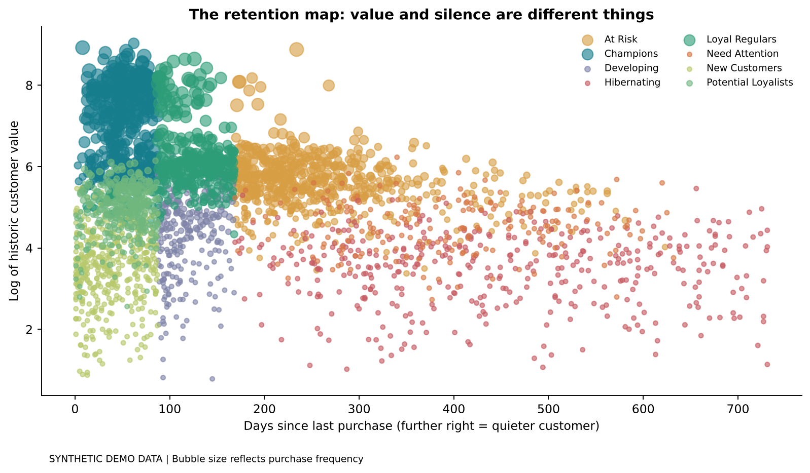

# The Repeat Purchase Lab

**Customer segmentation, retention and lifetime-to-date value analysis with Python, SQL and an interactive dashboard.**

A sales dashboard can tell a team how much it sold. This project asks a more useful question: which customer relationships should the team protect, grow or try to win back, and how should it test that decision?

The work turns transaction lines into customer-level measures and tells the story in three steps: **where value lives, where customers drift, and what to do next.** It is deliberately different from a marketplace operations dashboard: this one centres on customer relationships, time between purchases, cohort retention and a short-horizon repeat-purchase score.



> **Important about the included data:** `data/demo_transactions.csv` is a synthetic teaching file, clearly labelled as such. It is included so the dashboard and report work right away. The full analysis should be rerun against the free UCI source before any numeric finding is used on a resume or in an interview. The original workbook is not committed to this repository; a downloader is included.

## Start here

### 1. Install Python packages

Python 3.10 or newer is recommended.

```bash
python -m venv .venv
# Windows: .venv\Scripts\activate
# macOS/Linux: source .venv/bin/activate
python -m pip install -r requirements.txt
```

### 2. Run the included demo

```bash
python run_project.py --source demo
```

Open these files after the run:

- `outputs/dashboard.html` - a standalone interactive dashboard, with three guided chapters and filters.
- `reports/customer_retention_strategy_report.pdf` - a five-page business report.
- `outputs/insight_summary.md` - the run's findings and recommended actions.
- `visualizations/` - static charts for a README or portfolio case study.
- `outputs/customer_retention.sqlite` - a SQLite database for SQL practice.

The dashboard embeds its plotting library, so it can be opened locally without a dashboard server or a live internet connection.

### 3. Download and analyse the real public data

The project uses the [UCI Online Retail II dataset](https://archive.ics.uci.edu/dataset/502/online+retail+ii), a 1,067,371-row transaction dataset from a UK-based online retailer covering 1 December 2009 through 9 December 2011. UCI lists it under the CC BY 4.0 licence.

```bash
python run_project.py --source real --download
```

This downloads the workbook to `data/raw/online_retail_II.xlsx`, processes both sheets, and rebuilds the outputs from the original transactions. The raw workbook and processed extracts are ignored by Git so you do not accidentally commit a large source file or customer-level export. The project does not need a paid data service or cloud account. An internet connection is needed for the download step only.

If the downloader cannot reach UCI in your network, download the workbook manually from the UCI page above and save it as `data/raw/online_retail_II.xlsx`, then run:

```bash
python run_project.py --source real
```

## What's in the repository

```text
customer-segmentation-retention-ltv/
├── README.md
├── DESCRIPTION.md
├── DATA_LICENSE.md
├── run_project.py
├── requirements.txt
├── data/
│   ├── demo_transactions.csv        # synthetic, runs offline
│   ├── raw/                         # original workbook goes here, ignored by Git
│   └── processed/                   # prepared sales lines and customer orders
├── src/
│   ├── analysis.py                  # cleaning, RFM, cohorts, repeat model, charts
│   ├── build_dashboard.py           # standalone interactive story dashboard
│   ├── build_report.py              # PDF report generator
│   ├── download_data.py             # fetches the source workbook from UCI
│   └── generate_demo_data.py        # reproduces the synthetic demo file
├── sql/                             # RFM, cohort, concentration and action queries
├── notebooks/                       # walkthrough notebook
├── outputs/                         # dashboard data, CSVs, SQLite and report notes
├── reports/                         # business review PDF and method note
├── visualizations/                  # charts generated by the pipeline
├── docs/                            # data dictionary, methodology, interview notes
└── tests/                            # basic data and output checks
```

## The business questions

1. Which groups contribute most of the observed customer purchase value, and how concentrated is that value?
2. Which previously valuable customers have gone quiet?
3. How does the repeat-purchase pattern change across first-purchase cohorts?
4. How long do returning customers usually take to make a second purchase?
5. Can transaction history rank the chance of another purchase in the next 90 days better than a simple recency/frequency rule?
6. What does a retention test need to deliver to cover its contact cost under stated assumptions?

## What makes the work more than an RFM chart

- **Customer value concentration:** the Pareto curve shows how much observed value sits with the highest-value customers.
- **Cohort retention:** monthly groups make the repeat-purchase path visible rather than reporting one blended repeat rate.
- **Time to second purchase:** helps define a message window from observed behaviour instead of choosing one arbitrarily.
- **90-day repeat ranking:** trains on earlier, non-overlapping 90-day windows and evaluates on the latest 90-day window. The dashboard shows the observed repeat rate by score decile.
- **Value-at-risk proxy:** combines historic value and a relative risk score to help order a review queue. It is not a prediction of money that will be lost.
- **Retention scenario planner:** changes contact rate, cost, expected order value, contribution margin and assumed incrementality to see how the business case moves.

## Method in plain language

1. Read the transaction file and standardise its column names.
2. Remove exact duplicate rows. Keep cancellations and non-positive quantities out of the purchase analysis and record the counts in the data-quality output.
3. Calculate line value as quantity times unit price. Lines without a customer ID can still appear in sales totals, but cannot be assigned to a customer segment.
4. Aggregate lines into distinct customer invoices. Use invoice count, not line count, as purchase frequency.
5. Calculate recency, frequency and historic value. Score each from 1 to 5 by quintile, then assign an understandable segment name.
6. Group customers by the month of first purchase and calculate how many are active in each later calendar month.
7. Build training examples from earlier, non-overlapping 90-day windows; fit logistic regression using pre-snapshot history; evaluate on the latest 90-day window.
8. Write out CSV tables, a SQLite database, charts, an interactive dashboard and a PDF report.

## Data and value definitions

- **Historic customer value:** sum of observed purchase line value in the available data window. It is not customer profit.
- **Annualised historic value proxy:** a simple descriptive rate based on the customer's observed value and time in the window. It is not a future LTV forecast.
- **Repeat purchase:** a customer has at least two distinct invoices in the observed window.
- **Cohort retention:** the share of a first-purchase cohort with another invoice in a given calendar month. It is not same-day survival analysis.
- **90-day repeat probability:** modelled chance of at least one purchase in a defined 90-day window. It is not a campaign uplift estimate or lifetime value.
- **Value-at-risk proxy:** historic value multiplied by a relative recency/frequency/value risk score. It is a way to prioritise a review list, not guaranteed revenue at risk.

## Reproduce the output and test it

```bash
python run_project.py --source demo
python -m unittest discover -s tests -v
```

For the original UCI file, run the real-data command above before tests. The analysis script rewrites the output tables and report for the selected source mode.

## Portfolio guidance

Use the report and dashboard as a walkthrough. Lead with the business decision, show the trade-off between customer count and historic value, explain what the cohort chart can and cannot prove, and end with the proposed test. On a resume, state the data source, tools, method and validated result only after you have run the original source data.

## Source and citation

Chen, D. (2012). *Online Retail II* [Dataset]. UCI Machine Learning Repository. https://doi.org/10.24432/C5CG6D. See `DATA_LICENSE.md` for the source licence and attribution note.
